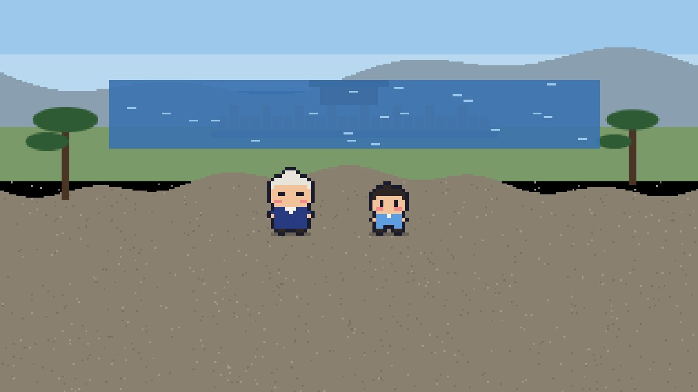

# pixel-anime ― ドット紙芝居

[English](README.md) | 日本語

ドット絵で動く紙芝居ムービー（見下ろし型RPG風）の再生エンジンです。作品はHTML1ファイルの台本で書きます。
文字はメッセージウィンドウに1文字ずつ流れ（名札・選択肢・ルビ・頭上の「！」）、BGMと効果音はWebAudioで合成するチップチューンです。作品は日英の2か国語にできます。

**デモ**：[pixel-anime.hs2g.com](https://pixel-anime.hs2g.com/)（ほかの作品も見られます）



サンプルとして、岡本綺堂「中国怪奇小説集」より「亀の眼」（`works/kame_rpg.html`）を1作だけ入れています。これを手本に、各自で`works/`に作品を足していきます。

## 始め方

Python 3と[Beautiful Soup 4](https://pypi.org/project/beautifulsoup4/)が必要です（Node.jsとpnpmはCloudflareへ公開するときだけ）。

```bash
pip install beautifulsoup4
python serve.py          # http://localhost:8765/ を開く
```

- `serve.py`はキャッシュさせないので、編集は再読み込みで反映されます。このPCからだけ開けます。`python serve.py 8765 0.0.0.0`で同じネットワークにも開きます（信頼できるネットワークでだけ）
- `works/kame_rpg.html?c=3&f=0.5`のように開くと、カット3の途中で一時停止した状態から始まります（確認やサムネイル撮りに）
- 操作：`Space`再生／停止、`← →`カット、`A`オート／マニュアル、`M`BGM、`S`効果音、`G`ドット／ゴシック、`C`人物の絵柄、`L`言語、`F`全画面

## 構成

```
index.html    作品の一覧（サムネイルは thumbs/、thumbs/en/）
works/        作品（1 作品 1 ファイル）
engine/       再生エンジン（core.js・rpg.js・songs.js・CSS）
cast/         共用の部品（kaiki_kit.js：部品から組む人物・小道具・背景）
admin.html    公開の管理画面（serve.py で開いたときだけ）
publish.json  公開する作品
build.py      公開用のサイトを dist/ に書き出す
serve.py      開発用のサーバー
```

## 作品の作り方

1. このリポジトリをClaude（Claude Codeなど）で開き、原典（URLか本文のファイル）を見せて、`works/kame_rpg.html`を手本に作品を作らせる。たとえば：
   > この話（URL）を読んで、`works/kame_rpg.html`を手本に`works/xxx_rpg.html`を作って。英語版も付けて
2. `serve.py`で再生して確かめ、気になる場面をClaudeに伝えて直させる（スクリーンショットを見せると伝わりやすい）
3. `index.html`にカードを足し（`data-n`は今までで一番大きい番号＋1。新しい順に並ぶ）、サムネイルを`thumbs/xxx_rpg.jpg`に置く（英語版は`thumbs/en/`にも）。これもClaudeに頼める

本文には、パブリックドメインか、使ってよい許諾のある文章だけを使ってください。

## 公開

公開する作品は`publish.json`に書きます（`serve.py`で開いた管理画面`admin.html`でも切り替えられます）。`python build.py`で、その作品だけを`dist/`に書き出します。中身は静的なファイルだけです。Cloudflare Workersに置くときは`wrangler.jsonc`の`name`（と`routes`）を自分のものに変えて：

```bash
pnpm install
pnpm cf:deploy    # 書き出して公開（プレビュー URL は pnpm cf:preview）
```

`serve.py`は開発用です。インターネットには公開しないでください。

## ライセンス

コードは[MIT License](LICENSE)です。
サンプルの本文：岡本綺堂「中国怪奇小説集」（[青空文庫](https://www.aozora.gr.jp/cards/000082/files/1298_11892.html)、パブリックドメイン）。英訳はClaude。
フォント（DotGothic16・Pixelify Sans・BIZ UDGothic・IBM Plex Mono・Shippori Mincho）はGoogle FontsからSIL Open Font Licenseで読み込みます。
