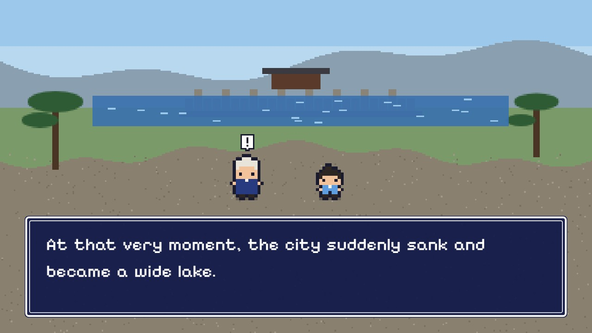

# pixel-anime: Pixel-Art Picture-Story Shows

English | [日本語](README.ja.md)

A playback engine for pixel-art picture-story movies styled like a top-down RPG. Each work is a script in a single HTML file.
Text types out in a message window (name tags, choices, ruby, "!" above heads), and music and sound effects are chiptunes synthesized with WebAudio. Works can be bilingual (Japanese / English).



One sample is included: "The Turtle's Eyes" (`works/kame_rpg.html`) from Kido Okamoto's *Chinese Tales of the Strange*. Use it as a model and add your own works under `works/`.

## Getting started

Requires Python 3 and [Beautiful Soup 4](https://pypi.org/project/beautifulsoup4/) (Node.js and pnpm only for deploying to Cloudflare).

```bash
pip install beautifulsoup4
python serve.py          # open http://localhost:8765/
```

- `serve.py` disables caching, so edits show up on reload. It listens on this machine only; `python serve.py 8765 0.0.0.0` opens it to your network (trusted networks only)
- `works/kame_rpg.html?c=3&f=0.5` opens paused partway through cut 3 (handy for checks and thumbnails)
- Keys: `Space` play / pause, `← →` cuts, `A` auto / manual, `M` music, `S` sound, `G` pixel / plain text, `C` sprite style, `L` language, `F` fullscreen

## Layout

```
index.html    list of works (thumbnails in thumbs/, thumbs/en/)
works/        works, one HTML file each
engine/       playback engine (core.js, rpg.js, songs.js, CSS)
cast/         shared parts (kaiki_kit.js: characters built from parts, props, backgrounds)
admin.html    admin page for publishing (only via serve.py)
publish.json  works to publish
build.py      writes the public site to dist/
serve.py      dev server
```

## Making a work

1. Open this repository in Claude (e.g. Claude Code), show it the original text (a URL or a text file), and ask it to make a work using `works/kame_rpg.html` as a model. For example:
   > Read this story (URL) and make it into a work at `works/xxx_rpg.html`, using `works/kame_rpg.html` as a model. Include an English version.
2. Play it with `serve.py`, and tell Claude about any scene that looks wrong so it can fix it (screenshots help)
3. Add a card to `index.html` (`data-n` = largest number so far + 1; newest first) and put a thumbnail at `thumbs/xxx_rpg.jpg` (and `thumbs/en/` for English). You can ask Claude to do this too
4. Make it public on the admin page (`http://localhost:8765/admin.html`)

Use only text that is in the public domain or that you have permission to use.

## Publishing

`python build.py` (or "Build for publishing" on the admin page) writes only the public works to `dist/`, which is plain static files. For Cloudflare Workers, set `name` (and `routes`) in `wrangler.jsonc`, then:

```bash
pnpm install
pnpm cf:deploy    # build and deploy (pnpm cf:preview for a preview URL)
```

`serve.py` is for development only. Do not expose it to the internet.

## License

Code: [MIT License](LICENSE).
Sample text: Kido Okamoto, *Chinese Tales of the Strange* ([Aozora Bunko](https://www.aozora.gr.jp/cards/000082/files/1298_11892.html), public domain); English translation by Claude.
Fonts (DotGothic16, Pixelify Sans, BIZ UDGothic, IBM Plex Mono, Shippori Mincho) are loaded from Google Fonts under the SIL Open Font License.
